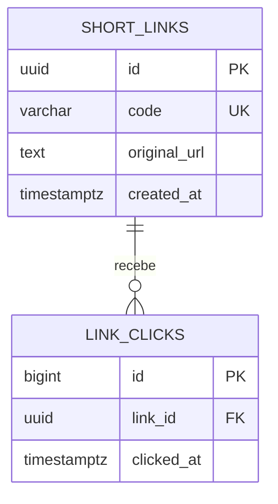

# Explicação do projeto: encurtador de links

Neste documento registrei como construí o encurtador, como o redirecionamento produz dados de análise e quais limites deixei para evoluir. As chamadas completas estão em docs/API.md.

## O que eu implementei

Implementei criação de links curtos, validação de destinos HTTP/HTTPS, redirecionamento HTTP 302, registro de cada clique e consulta de totais por período. O código compila; ainda não executei a API conectada ao PostgreSQL neste ambiente.

## Como organizei os arquivos

```text
04-encurtador-links/
├── docs/
│   ├── API.md
│   └── GUIA_DE_ESTUDO.md
├── src/main/java/br/com/portfolio/links/
│   ├── LinksApplication.java
│   ├── LinkController.java
│   ├── LinkDtos.java
│   └── LinkService.java
├── src/main/resources/
│   ├── application.properties
│   └── db/migration/V1__schema_inicial.sql
├── compose.yaml
├── pom.xml
└── README.md
```

LinkController define as rotas. LinkDtos descreve o que a API recebe e devolve. LinkService valida destino, gera o código, consulta o link, grava cliques e prepara as estatísticas.

## Modelo que escolhi



Eu separo o mapeamento (`short_links`) dos eventos de uso (`link_clicks`). Assim, o destino fica num registro estável e as visitas podem ser contadas por período. O índice `(link_id, clicked_at DESC)` atende ao filtro principal das estatísticas.

## Como crio um link curto

1. Recebo a URL e verifico presença e tamanho.
2. Converto o texto para URI e aceito somente HTTP ou HTTPS, com host e sem credenciais embutidas.
3. Gero um código aleatório de oito caracteres usando Base62.
4. Tento inserir. Se a constraint UNIQUE informar uma colisão, gero outro código e tento novamente.

Eu deixo a constraint UNIQUE do PostgreSQL decidir a unicidade porque uma checagem prévia na aplicação teria uma janela de corrida entre instâncias.

## Como registro e contabilizo cliques

Quando alguém chama GET /r/{code}, procuro o destino, insiro o horário em link_clicks e respondo 302 com Location. A escrita acontece antes da resposta; por isso, cada visitante espera a confirmação do PostgreSQL.

As estatísticas agrupam os registros por dia UTC. from e to são datas inclusivas; totalClicks conta os eventos dentro da mesma janela. Dias sem eventos não aparecem na lista.

Eu não busco a URL no servidor: apenas valido o destino e o devolvo no cabeçalho Location. Isso mantém o backend fora do papel de cliente HTTP arbitrário.

## Privacidade e limites que registrei

Não armazeno IP, user-agent, localização ou outros dados de visita. O MVP não tem autenticação, rate limiting, expiração de links nem retenção dos eventos. Um serviço público de encurtamento precisa de controles para abuso, moderação de destinos e política de retenção.

## Próximos passos que anotei

- Adicionar expiração e desativação de links.
- Permitir um slug escolhido pelo usuário e tratar colisões com HTTP 409.
- Definir retenção e agregação histórica de cliques.
- Se eu mover a gravação para Redis Streams ou uma fila, documentar retentativas, duplicidade e consistência eventual.

